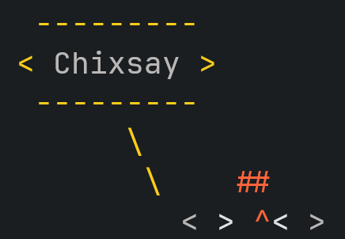

<div align="center">
  

  <h1>Chixsay</h1>
  <p>cowsay, but for chickens.</p>

  <a href="LICENSE">
    
  </a>
  
  
  <br>
  
  
  
  
</div>

---

## Installation

```sh
cargo install chixsay
```

Or build from source:

```sh
git clone https://github.com/niwatoriiiiiiiii/chixsay
cd chixsay
cargo build --release
```

Requires Rust 1.85.1 or leter.

## Usage

```sh
chixsay 'Hello, world!'
chixsay --tired 'I need a nap'
chixsay 'hello!' | chixsay | chixsay
chixsay -- '-text-'
echo 'hello' | chixsay
```

## Options

| Option              | Expression              |
| ------------------- | ----------------------- |
| `-b`, `--borg`      | `= ^=`                  |
| `-c`, `--crying`    | `T ^T`                  |
| `-d`, `--dead`      | `x ^x`                  |
| `-g`, `--greedy`    | `$ ^$`                  |
| `-m`, `--meh`       | `U ^U`                  |
| `-p`, `--paranoid`  | `@ ^@`                  |
| `-s`, `--stoned`    | `* ^*`                  |
| `-t`, `--tired`     | `- ^-`                  |
| `-w`, `--wired`     | `O ^O`                  |
| `-y`, `--youthful`  | `. ^.`                  |
| `-q`, `--quiet`     | Hide the speech bubble  |
| `-W`, `--width <N>` | Wrap at N columns       |
| `-n`, `--no-wrap`   | Do not wrap the message |
| `--think`           | Use a thought bubble    |
| `-V`, `--version`   | Show version            |
| `-h`, `--help`      | Show help               |

Colors are disabled when the output is piped or `NO_COLOR` is set.

## Acknowledgements

Inspired by [cowsay](https://github.com/cowsay-org/cowsay).

## License

This project is dual-licensed under either of:

- Apache License, Version 2.0 ([LICENSE-APACHE](LICENSE-APACHE) or <https://www.apache.org/licenses/LICENSE-2.0>)
- MIT License ([LICENSE-MIT](LICENSE-MIT) or <https://opensource.org/licenses/MIT>)

at your option.

### Contribution

Unless you explicitly state otherwise, any contribution intentionally submitted for inclusion in the work by you, as defined in the Apache-2.0 license, shall be dual licensed ad above, without any additional terms or conditions.
